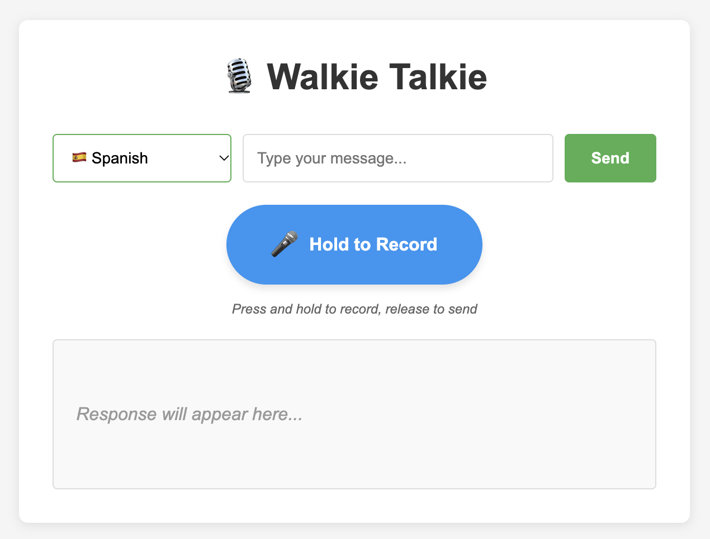

# 🎙️ Walkie Talkie

Practice speaking a foreign language with an AI conversation partner. Type a message or hold a button and talk. The AI teacher answers in the language you're learning, points out your mistakes, and reads the reply out loud.



## Features

- 🗣️ **Voice or text input.** Press and hold to record, release to send. Drag left while holding to cancel.
- 🔊 **Spoken replies.** Every answer is also generated as audio with the right accent.
- ✏️ **Corrections.** The teacher highlights mistakes in your message and then replies to what you said.
- 🌍 **Five languages.** English, Polish, Ukrainian, Italian and Spanish.
- 🧵 **Separate conversation per language.** Switch languages and come back to where you left off.

## How it works

```
Browser ──POST /chat──▶ handler ──▶ service ──▶ ai (OpenAI)
  ▲   (JSON or audio)                              │
  │                                                ├─ Whisper         speech → text
  └──── reply + base64 audio + responseId ◀────────├─ Responses API   text → teacher reply
                                                   └─ TTS             reply → speech
```

1. The frontend sends either JSON (typed text) or `multipart/form-data` (a recorded audio clip) to `POST /chat`, together with the selected language.
2. For audio, the clip is transcribed with Whisper.
3. The text is sent to the OpenAI Responses API. On the first message of a conversation, the system prompt is prepended, with `$LANGUAGE` replaced by the chosen language.
4. The reply is turned into speech with `gpt-4o-mini-tts` and returned as base64 next to the text. If speech generation fails, you still get the text reply.

### Decisions made

- **No server-side state.** OpenAI stores the conversation (`store: true`). The browser keeps the last `previousResponseId` in a cookie, one per language, and sends it with the next request.
- **Thin layers.** The `handler` deals with HTTP only. The `service` holds the business logic (language validation, audio fallback). The `ai` package is internal to the service and hidden behind an interface, so the service is tested with a mock and no API calls.
- **Minimal dependencies.** Standard-library HTTP server and a vanilla HTML/CSS/JS frontend. The only dependency is the official `openai-go` SDK.
- **Prompt lives in a file.** Edit `internal/prompts/system.txt` to change the teacher's behaviour. No rebuild is needed, just restart.

## Project structure

```
main.go                          server setup, routing, graceful shutdown
internal/
  config/                        environment variables
  handler/chat.go                POST /chat (text and audio)
  service/                       business logic + tests
    internal/ai/                 OpenAI calls: chat, Whisper, TTS
  prompts/system.txt             the teacher's system prompt
static/                          frontend (index.html, app.js, style.css)
```

## Running it

### Prerequisites

- Go 1.25+
- An [OpenAI API key](https://platform.openai.com/api-keys). Note that each message calls paid APIs.

### Configuration

| Variable         | Required | Default       | Description                          |
|------------------|----------|---------------|--------------------------------------|
| `OPENAI_API_KEY` | yes      |               | Your OpenAI API key                  |
| `OPENAI_MODEL`   | no       | `gpt-4o-mini` | `gpt-4o` or `gpt-4o-mini`; any other value falls back to `gpt-4o-mini` |
| `PORT`           | no       | `8080`        | Port the server listens on           |

### Start

```sh
export OPENAI_API_KEY=sk-...
go run main.go
```

Then open <http://localhost:8080> and allow microphone access when asked.

Alternatively, put your variables in `.dev/.env` (git-ignored) and run `make dev`:

```sh
mkdir -p .dev && echo 'OPENAI_API_KEY=sk-...' > .dev/.env
make dev
```

> Run the server from the repository root. It reads `static/` and `internal/prompts/system.txt` using relative paths.
>
> Browsers only allow microphone access on `localhost` or over HTTPS.

### Tests

```sh
go test -race ./...
```

The same command runs in CI on every push and pull request to `main`.
